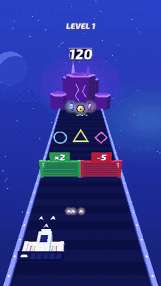
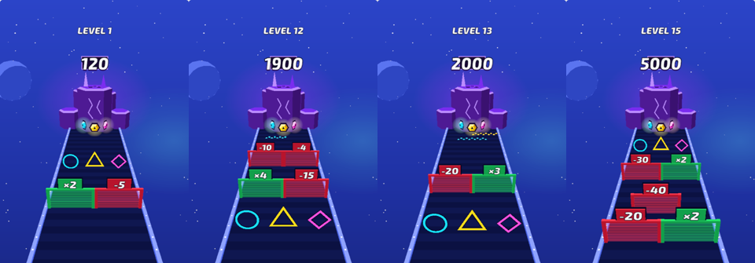
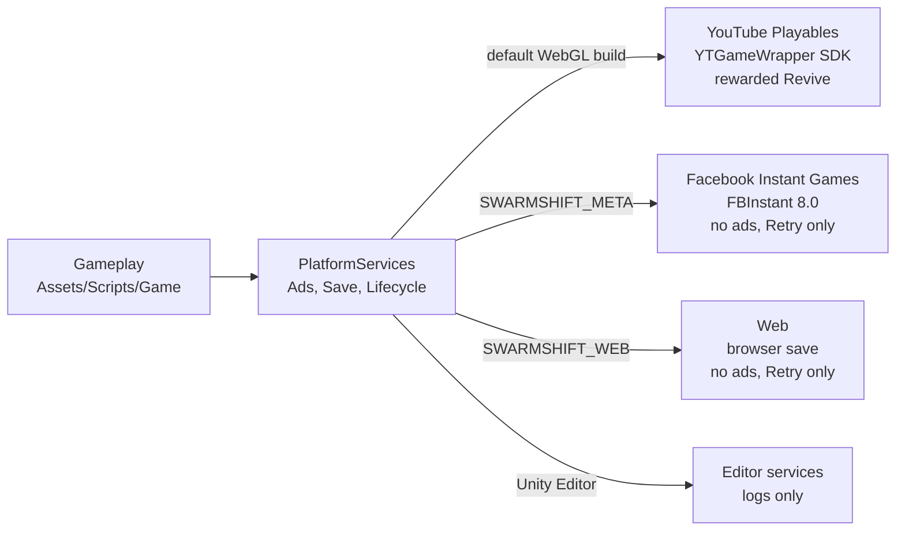

<p align="center"></p>

<p align="center"><b>A one-thumb crowd game for your phone</b></p>

<p align="center">Hold to launch a swarm, slide to steer it through gates and warp rings, and crack the hive's number.</p>

<p align="center">
  
  
  
  
</p>

<p align="center">
  <a href="https://swarmshift.pasindug.com/play/">Play in your browser</a> |
  <a href="https://swarmshift.pasindug.com">Website</a> |
  <a href="#builds">Builds</a> |
  <a href="#project-layout">Project layout</a>
</p>

<p align="center"></p>

## How it plays

- **Hold** to launch white drones from the mothership. **Slide** to steer where they launch.
- **Gates** multiply the swarm (`x2`, `x3`) or cut it (`-5`, `-20`). Pick the right side.
- **Warp rings** charge drones cyan, yellow or magenta.
- **Enemies** come in the same three colours. A drone beats an enemy of its own colour and trades one for one with any other.
- **The hive** shows a number. Get enough drones through to bring it to zero and the level is won.

<p align="center"><br><sub>Level 1, 12, 13 and 15. Levels 13 to 15 are the hard ones: one narrow route through stacked gate rows.</sub></p>

## What's in it

- **15 levels**, from a single gate row to three hard levels built around a single route.
- **One project, three builds.** YouTube Playables, Facebook Instant Games and a plain web build share every line of gameplay. Only the platform services change.
- **Built to Playables limits.** One thread, no network calls, no analytics, no Unity services. Units are plain data drawn with GPU instancing, with no Rigidbody or collider per unit.
- **Levels as code.** `Assets/Editor/BuildLevels.cs` writes every level scene, so a layout change is a diff, not a hand edit in the Editor.
- **Saves where the platform wants them.** The YouTube SDK on Playables, Meta's player data on Facebook, the browser on the web.

## How the builds differ



`PlatformServices` picks the services at compile time from the scripting define, and each build has its own WebGL template in `Assets/WebGLTemplates/`.

## Builds

Each build is a menu item under **SWARMSHIFT** in the Editor, or a Unity CLI call:

```
unity build --target WebGL --execute-method BuildWeb.BuildRelease -o Builds/Web .
unity build --target WebGL --execute-method BuildWeb.BuildMeta -o Builds/Meta .
unity build --target WebGL --execute-method BuildWeb.BuildSite -o Builds/Site .
```

| Build | Method | Template | Compression | Size | Status |
|---|---|---|---|---|---|
| YouTube Playables | `BuildRelease` | `YTGameWrapperTemplate` | Disabled, as Playables requires | 24.9 MiB (limit 30 MiB) | Built, passes Google's Test Suite; waiting on a Playables invitation |
| Facebook Instant Games | `BuildMeta` | `FBInstantTemplate` with `fbapp-config.json` | Gzip with decompression fallback | not measured yet | Code written and compiling, not built yet |
| Web | `BuildSite` | `SiteTemplate` | Gzip with decompression fallback | 8.9 MB | Live at [swarmshift.pasindug.com/play](https://swarmshift.pasindug.com/play/) |

The Meta and web builds switch the template and compression for one build and put the YouTube settings back afterwards. If a build is stopped part way, check `webGLTemplate`, `webGLCompressionFormat` and `webGLDecompressionFallback` in `ProjectSettings/ProjectSettings.asset` before the next Playables build.

## Project layout

```
Assets/
  Scripts/Game/        gameplay: swarm, gates, warp rings, mites, hive, level flow
  Scripts/Platform/    ads, save and lifecycle per platform, YouTube SDK wrapper
  Editor/              BuildLevels.cs (level scenes), BuildWeb.cs (the three builds)
  Plugins/             jslib bridges: YouTube SDK, Meta SDK, main loop pause
  WebGLTemplates/      YTGameWrapperTemplate, FBInstantTemplate, SiteTemplate
  Scenes/              Level01 to Level15
docs/images/           README media
```

## Stack

Unity 6000.6.7f1 with URP, the Input System, uGUI with TextMeshPro, and the Unity CLI with the Pipeline package for builds from the command line.
The Editor is driven from the terminal; see `.claude/skills/unity-cli/`.

## Made by

[Pasindu Premachandra](https://pasindug.com). Software engineer in Sri Lanka. Alongside VaniBot and crewrota, SWARMSHIFT is one of the products I build after hours.
